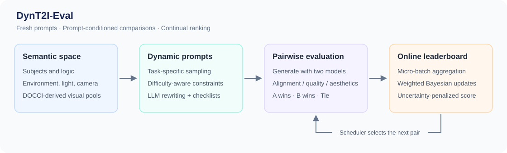

# DynT2I-Eval: A Dynamic Evaluation Framework for Text-to-Image Models (NeurIPS 2026)

[](https://neurips.cc/)
[](https://arxiv.org/abs/2605.06170)
[](docs/installation.md)
[](LICENSE)

**Juntong Wang, Jiarui Wang, Huiyu Duan, Lewei Li, Guangtao Zhai, Xiongkuo Min**

Institute of Image Communication and Network Engineering, Shanghai Jiao Tong University, Shanghai, China

**[Paper](https://arxiv.org/abs/2605.06170)** · **[PDF](https://arxiv.org/pdf/2605.06170)** · **[HTML](https://arxiv.org/html/2605.06170v1)**

**DynT2I-Eval** evaluates text-to-image models with continually refreshed prompts and an online Bayesian leaderboard. A structured visual semantic space supports task-specific prompt sampling, while a dynamic scheduler selects model pairs and aggregates their outcomes across three evaluation dimensions.



| Dimension | Prompt design | Default evaluator | Pairwise outcome |
| --- | --- | --- | --- |
| Text alignment | Subject, logic constraint, and visual context; four difficulty tiers | Qwen3.5-9B, with image-order swapping | A, B, or Tie from two judgments |
| Perceptual quality | Visually rich scenes with a low semantic burden | VisualQuality-R1-7B | Win probability from sampled quality scores |
| Aesthetic quality | Shares the quality prompt stream | ArtiMuse | Score difference with a configurable tie threshold |

The ranking system combines prompt-level outcomes into micro-batches, applies weighted Bayesian updates, and ranks models using an uncertainty-penalized score. Prompt streams can grow between rounds, and new models can enter an existing leaderboard.

## Quick start

Run commands from the repository root. Python 3.10 or newer is required.

### 1. Try the ranking system on CPU

This example uses **synthetic outcomes** to demonstrate scheduling, micro-batch aggregation, and ranking. It downloads no models and produces no research results.

```bash
python -m venv .venv
source .venv/bin/activate
python -m pip install -r requirements-core.txt
python scripts/demo_ranking.py --rounds 40 --seed 42
```

### 2. Configure model inference

The full benchmark needs CUDA GPUs, local model checkpoints, Conda environments for generation workers, and external evaluator implementations. See the [installation guide](docs/installation.md) for setup and the [model list](docs/models.md) for registry names and inference settings.

```bash
python -m pip install -r requirements.txt
cp configs/runtime.example.json configs/runtime.json
```

Edit `configs/runtime.json` with your checkpoint paths, external source directories, and Conda environment names. To use a different file across builders, services, and schedulers:

```bash
export DYNT2I_EVAL_CONFIG=/absolute/path/to/runtime.json
```

Check the configuration for a small alignment run:

```bash
python scripts/check_setup.py --dimension text_alignment --models SDXL-Base-1.0 SD-3.5-Medium
```

### 3. Build a fresh prompt stream

Run the alignment builder in an environment containing a Transformers version that supports Qwen3.5:

```bash
CUDA_VISIBLE_DEVICES=2 python build_text_alignment_set.py --count 200 --seed 42
```

Generate the shared perceptual and aesthetic quality stream:

```bash
python build_perceptual_quality_set.py --count 200 --seed 42 --gpu 2 --conda-env qwen3.5
```

Builders append records by default. Repeat a command to extend the stream; use a new output directory for an independent stream. Seeds control tag sampling; inference also depends on the model and software environment. [Prompt formats and sampling](docs/prompts.md) describes the outputs and includes small, hand-written examples.

### 4. Start an evaluator and run a benchmark

For text alignment, start the judge in a separate terminal:

```bash
CUDA_VISIBLE_DEVICES=2 python -m benchmark.evaluator.alignment_server
```

Once the judge is ready, run two generation models on GPUs 0 and 1:

```bash
python text_alignment_benchmark.py --models SDXL-Base-1.0 SD-3.5-Medium --gpu-a 0 --gpu-b 1 --rounds 5 --prompts prompt_builders/output/alignment_main/alignment_main.jsonl
```

For the other dimensions, use the corresponding service and scheduler:

| Dimension | Service command | Scheduler command |
| --- | --- | --- |
| Perceptual quality | `python -m benchmark.evaluator.perceptual_quality_server` | `python perceptual_quality_benchmark.py` |
| Aesthetic quality | `python -m benchmark.evaluator.aesthetic_quality_server` | `python aesthetic_quality_benchmark.py` |

Bind each service to suitable GPUs using `CUDA_VISIBLE_DEVICES`. The defaults use ports 8000, 8001, and 8002 respectively. Run one dimension at a time, or assign separate resources and state files. Omitting `--models` selects all 13 registered generation models; all selected models need usable checkpoints and environments.

`--rounds 0` runs until prompts are exhausted or no eligible pair remains. Ratings reach a minimum uncertainty but models stay active by default, allowing evaluation to continue on fresh prompts. Existing state resumes automatically. See [configuration and recovery](docs/configuration.md) before changing models or prompt files for an existing run.

## Outputs and analysis

Each dimension writes images, per-round tasks and outcomes, and `score_history.jsonl` under `benchmark_outputs/<dimension>/`. Its resumable state is stored in `benchmark_states/<dimension>.json`.

```bash
python scripts/report_round_rankings.py --output-dirs benchmark_outputs/text_alignment --rounds 1 3 5
python scripts/analyze_rank_stability.py --output-dirs benchmark_outputs/text_alignment --reference-round 1 --end-round 5 --checkpoints 1 3 5
```

This repository contains the benchmark implementation and prompt resource pools. Model weights and historical experiment outputs are not bundled. The synthetic demo does not reproduce a paper leaderboard.

## Repository layout

```text
benchmark/                 Shared scheduler, ranking policy, model registry
  generators/              Model adapters and subprocess worker
  evaluator/               Alignment, perceptual, and aesthetic services
prompt_builders/            Task-specific prompt sampling and rewriting
  resources/               Structured visual semantic pools
configs/                   Portable runtime configuration example
examples/                  Hand-written prompt format examples
scripts/                   CPU demo, setup check, and ranking analysis
docs/                      Installation, configuration, prompts, and models
tests/                     CPU regression tests
```

## Citation

If you use DynT2I-Eval, please cite the paper. The complete reference is also available in [CITATION.bib](CITATION.bib) and [CITATION.cff](CITATION.cff).

```bibtex
@misc{wang2026dynt2ieval,
  title         = {{DynT2I-Eval}: A Dynamic Evaluation Framework for Text-to-Image Models},
  author        = {Juntong Wang and Jiarui Wang and Huiyu Duan and Lewei Li and Guangtao Zhai and Xiongkuo Min},
  year          = {2026},
  eprint        = {2605.06170},
  archivePrefix = {arXiv}
}
```

## License and acknowledgments

The project code is released under the [MIT License](LICENSE). Model checkpoints, external implementations, and source datasets retain their own terms. The prompt resource pools are derived from DOCCI descriptions; see [third-party notices](THIRD_PARTY_NOTICES.md) for provenance and attribution.

DynT2I-Eval builds on Qwen3.5, VisualQuality-R1, ArtiMuse, Q-Insight, Hugging Face Diffusers and Transformers, and the text-to-image models listed in [docs/models.md](docs/models.md).
